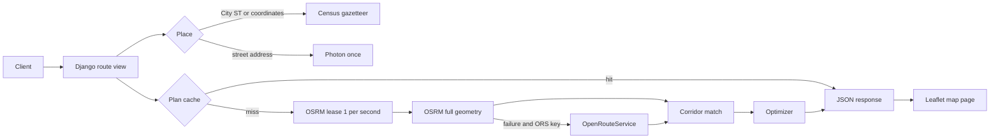

# Spotter fuel-route API

Backend Django REST API. It plans a US drive and the truck stops that minimize fuel spend for a 500-mile tank.

## Contents

- [Live demo](#live-demo)
- [What this is](#what-this-is)
- [Quickstart](#quickstart)
- [Project structure](#project-structure)
- [Architecture](#architecture)
- [Environment](#environment)
- [API](#api)
- [Performance](#performance)
- [Data](#data)
- [Testing](#testing)
- [Troubleshooting](#troubleshooting)
- [Docker deploy](#docker-deploy)
- [Postman](#postman)
- [Decisions](#decisions)

## Live demo

- Health: https://spotter.kadamsahil.com/api/v1/health
- Chicago, IL → Houston, TX: https://spotter.kadamsahil.com/api/v1/route?start=Chicago,%20IL&finish=Houston,%20TX
- Map: https://spotter.kadamsahil.com/api/v1/map?start=Chicago,%20IL&finish=Houston,%20TX

The same paths on a laptop use `http://127.0.0.1:8000`.

## What this is

This is a backend-only Django REST API. There is no separate frontend. `/api/v1/map` is a small server-rendered Leaflet page so a reviewer can see the line and the stops. The browser loads tiles. It does not call the router.

## Quickstart

Python 3.12 or newer. No Redis, no API key, and no geocoding step. `data/stations.json` is already in the repo. If `REDIS_URL` is unset, the cache and the one-request-per-second OSRM limiter stay in this process.

```bash
python3 -m venv .venv && source .venv/bin/activate && pip install -r requirements.txt && python manage.py migrate && python manage.py runserver
```

```bash
curl -sS 'http://127.0.0.1:8000/api/v1/route?start=Chicago,%20IL&finish=Houston,%20TX'
python manage.py test fuel
```

Dependencies in `requirements.txt` are pinned, including transitive packages. They are pure-Python wheels. Nothing needs GDAL or another system library.

## Project structure

| Path | Purpose |
|---|---|
| `manage.py` | Django entry point |
| `config/settings.py` | Settings. LocMem when `REDIS_URL` is empty. Redis when it is set |
| `config/urls.py` | Mounts `fuel.urls` |
| `fuel/views.py` | `/`, `/api/v1/health`, `/route`, `/map` |
| `fuel/services/plan.py` | Ties resolve, route, corridor, and optimizer into the JSON body |
| `fuel/services/resolve.py` | Coordinates, Census gazetteer, or one Photon lookup. US check |
| `fuel/services/routing.py` | One OSRM call. OpenRouteService only if that call fails and a key is set |
| `fuel/services/limiter.py` | One OSRM start per second. Redis in production, in-process otherwise |
| `fuel/services/corridor.py` | Stops within `corridor_miles` of the full route line |
| `fuel/services/optimizer.py` | Minimum dollars on that line. Starting tank is not billed |
| `fuel/services/geo.py` | Haversine, polyline, mile markers, Douglas–Peucker |
| `fuel/services/stations.py` | Loads `data/stations.json` once per process |
| `fuel/services/poi_match.py` | Brand-word overlap required before a Photon hit is a specific stop |
| `fuel/services/regions.py` | US and Canadian state names. Point-in-US boxes |
| `fuel/services/catalog.py` | CSV collapse: one row per OPIS ID, minimum price |
| `fuel/templates/fuel/map.html` | Leaflet page. Popup text is escaped |
| `fuel/tests/` | 22 tests. No network |
| `data/stations.json` | Precomputed stops. Required at runtime |
| `data/us_places.json` | Census place centroids for `City, ST` |
| `data/fuel-prices.csv` | Source prices. Not read on a request |
| `scripts/geocode_stations.py` | Resumable offline geocoder |
| `scripts/build_places.py` | Rebuilds the Census gazetteer JSON |
| `Dockerfile`, `docker-compose.yml` | Gunicorn on `127.0.0.1:8001` plus a private Redis |
| `docker/entrypoint.sh` | Migrate, then Gunicorn. Refuses debug when `DOMAIN` is set |
| `deploy/deploy.sh` | VPS start. Checks p1 first |
| `deploy/install-nginx.sh` | New nginx site, `nginx -t`, reload, optional Certbot |
| `deploy/nginx/spotter.kadamsahil.com.conf` | Proxy to `127.0.0.1:8001` |
| `postman/spotter-fuel-route.postman_collection.json` | Collection. `baseUrl` defaults to localhost:8000 |
| `docs/` | Longer reference: API fields, data, tests, deploy, decisions |

## Architecture



Detail is in [docs/decisions.md](docs/decisions.md).

## Environment

Copy `.env.example` only if you want to override a default. Local `runserver` works with an empty environment.

| Variable | Default | Used for |
|---|---|---|
| `DJANGO_DEBUG` | `1` | `0` on the VPS. Debug on plus `DOMAIN` set refuses to boot in Docker |
| `DJANGO_SECRET_KEY` | dev key when debug is on | Required when `DJANGO_DEBUG=0` |
| `DJANGO_ALLOWED_HOSTS` | `localhost,127.0.0.1` | Compose sets the public names and keeps `127.0.0.1,localhost` for the healthcheck |
| `DJANGO_CSRF_TRUSTED_ORIGINS` | empty | `https://spotter.kadamsahil.com` on the VPS. The API does not use session auth |
| `SQLITE_PATH` | `db.sqlite3` | Django tables only. `/data/db.sqlite3` in Docker |
| `REDIS_URL` | empty | Empty: LocMem and an in-process limiter. Compose sets `redis://redis:6379/0` |
| `OSRM_BASE_URL` | `https://router.project-osrm.org` | Driving route. No key |
| `PHOTON_BASE_URL` | `https://photon.komoot.io` | Street addresses and towns missing from the gazetteer. No key |
| `ORS_BASE_URL` | `https://api.heigit.org` | Used only after OSRM fails |
| `ORS_API_KEY` | empty | Leave empty. One directions call when OSRM fails and this is set |
| `ROUTING_USER_AGENT` | `SpotterFuelRoute/1.0 (assessment)` | Sent on every outbound call |
| `STATIONS_PATH` | `data/stations.json` | Stop file |
| `PLACES_PATH` | `data/us_places.json` | Census places |
| `DOMAIN` | empty | Set in Compose so a debug env cannot boot |
| `WEB_CONCURRENCY` | `2` in the image | Gunicorn processes. Local `runserver` ignores it |
| `GUNICORN_THREADS` | `4` in the image | Threads per worker |
| `CORRIDOR_MILES`, `TANK_RANGE_MILES`, `MPG` | `10`, `500`, `10` | Listed in `.env.example`. The request overrides them. They are not read from the environment by the view |

## API

`GET` or `POST /api/v1/route`. Places are `City, ST`, `lat,lng`, or `{"lat","lng"}`. Defaults: 500 mile tank, 10 mpg, 10 mile corridor.

Chicago → Houston, measured. Geometry shortened. 209 points in the live body (`docs/samples/chi-hou-cold.json`):

```json
{
  "feasible": true,
  "start": {"label": "Chicago, IL", "lat": 41.837045, "lng": -87.684939, "resolved_by": "gazetteer"},
  "finish": {"label": "Houston, TX", "lat": 29.785743, "lng": -95.388806, "resolved_by": "gazetteer"},
  "route": {
    "distance_miles": 1083.1,
    "duration_seconds": 71592,
    "geometry": {"type": "LineString", "coordinates": [[-87.68489, 41.83705], [-95.38881, 29.78576]]},
    "provider": "osrm"
  },
  "total_gallons": 58.39,
  "total_fuel_cost": 168.06,
  "fuel_stops": [
    {
      "opis_id": "69861",
      "name": "HUCKS FOOD & FUEL #379",
      "city": "Marion",
      "state": "IL",
      "price_per_gallon": 2.929,
      "mile_marker": 312.1,
      "gallons": 28.881,
      "cost": 84.59,
      "geocode_quality": "poi"
    }
  ],
  "gap": null,
  "external_calls": {"geocode": 0, "route": 1},
  "cache": "miss",
  "elapsed_ms": 1006.9
}
```

The other stops are Texarkana, Marshall, Carthage, and Lufkin. New York → Los Angeles is 2,810.4 miles, 17 stops, $697.28 (`docs/samples/ny-la-cold.json`).

Every field, with units, and the error bodies (missing input, unknown city, Canada, infeasible `gap`) are in [docs/api.md](docs/api.md).

## Performance

Measured with `runserver`, no Redis, against the public OSRM demo. `elapsed_ms` is server time.

| Route | Cold `elapsed_ms` | Cold wall | Calls | Warm `elapsed_ms` | Warm wall | Calls |
|---|---|---|---|---|---|---|
| Chicago → Houston | 1006.9 | 1.01 s | 1 route, 0 geocode | 0.2 | 0.002 s | 0 |
| New York → Los Angeles | 1860.8 | 1.86 s | 1 route, 0 geocode | 0.3 | 0.003 s | 0 |

A cold miss stores the finished plan. The key is the rounded coordinates, tank, mpg, corridor, and the station-file timestamp. A hit does not call OSRM or Photon. The road geometry is cached separately, so a station-file change does not repeat the OSRM call. Before a miss, the process takes a one-second lease so two workers cannot both call OSRM. The public demo's limit is per source IP, so other containers on the VPS share it.

## Data

`data/stations.json` was built offline. 6,738 stops: **860** Photon POIs whose name matches the stop, **5,823** city centroids (Census, or a fallback when the POI was not specific), **55** unresolved and excluded. How to regenerate: [docs/data.md](docs/data.md).

## Testing

```bash
python manage.py test fuel
```

22 tests, no network. What each file covers: [docs/testing.md](docs/testing.md).

## Troubleshooting

macOS, Apple Silicon or Intel. The pins are pure Python and do not need Homebrew libraries.

- `python3 --version` should be 3.12 or newer. `python3 -m venv .venv` uses that interpreter. If `venv` is missing, install Python from python.org. The project does not need `python3-venv` from Homebrew.
- Activate with `source .venv/bin/activate`. `source .venv/bin/activate.fish` on fish. The prompt should show `(.venv)` before `pip` and `python`.
- `Address already in use` means something is on port 8000. `lsof -nP -iTCP:8000 -sTCP:LISTEN`, stop it, or `python manage.py runserver 127.0.0.1:8001` and curl that port.
- A first Chicago → Houston call takes about a second because OSRM does. A hang past about 15 seconds, or HTTP 502 `Routing failed`, is the public demo timing out or refusing. Wait and repeat the same URL. The second call should be a cache hit. Do not loop the endpoint. The limiter allows about one new route per second.
- `Invalid HTTP_HOST header` on the laptop means `DJANGO_ALLOWED_HOSTS` was overridden and dropped `localhost`. Unset it, or set `localhost,127.0.0.1`.

## Docker deploy

For the VPS that already runs p1. Not required to try the API.

`DJANGO_ALLOWED_HOSTS` in Compose is `spotter.kadamsahil.com`, `srv1208763.hstgr.cloud`, `127.0.0.1`, and `localhost`. The last two are there because the container healthcheck calls `http://127.0.0.1:8001/api/v1/health`. Without them Django returns 400 and Docker marks `spotter-web` unhealthy. Public requests still use the domain, through nginx.

```bash
cp .env.example .env
# DJANGO_DEBUG=0 and a real DJANGO_SECRET_KEY. Compose sets REDIS_URL.
bash deploy/deploy.sh
sudo bash deploy/install-nginx.sh
sudo ISSUE_CERT=1 bash deploy/install-nginx.sh
```

DNS is an A record `spotter` → `72.61.242.96`. No AAAA. Rollback, which does not stop p1: `docker compose -p spotter down`.

Steps, the p1 checks, and the swap note: [docs/deploy.md](docs/deploy.md).

## Postman

Import `postman/spotter-fuel-route.postman_collection.json`. `baseUrl` is `http://127.0.0.1:8000`. On the VPS set it to `https://spotter.kadamsahil.com`.

Requests: health, Chicago → Houston, New York → Los Angeles, Chicago as lat/lng, New York → Philadelphia (under 500 miles), Toronto rejected, Chicago map.

## Decisions

One OSRM route, then the cheapest pumps on that line. Full tank at the start is not billed. Redis only when more than one process must share the cache. The longer write-up and the list of later work: [docs/decisions.md](docs/decisions.md).

Map tiles © OpenStreetMap contributors. Routes from the OSRM demo or OpenRouteService. Places from Photon and the US Census Bureau. Prices from the assessment CSV.
